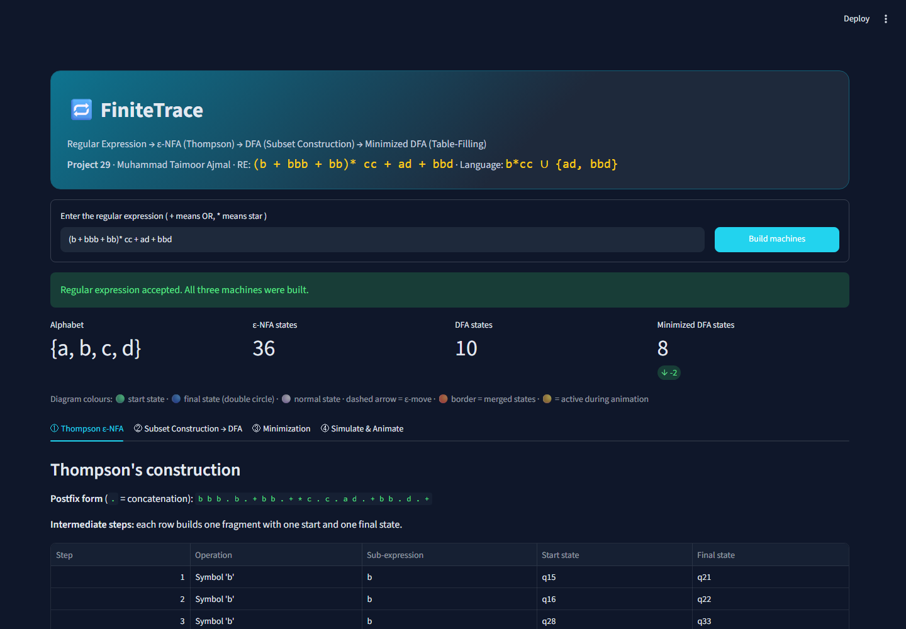
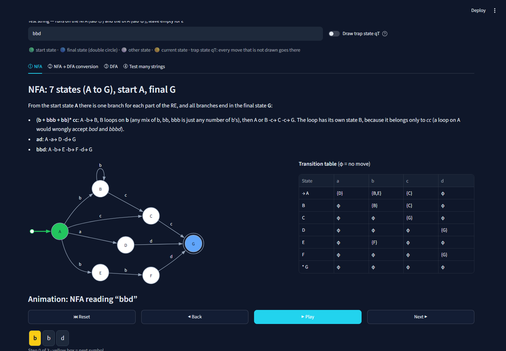
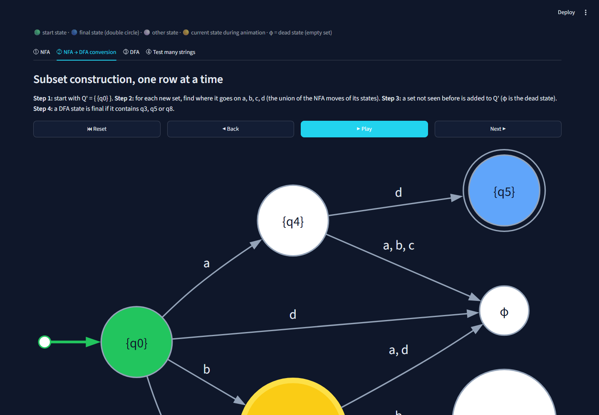

# FiniteTrace: Project 29

**Regular Expression → NFA → NFA to DFA conversion → DFA, with step-by-step animation.**

Semester project for *Theory of Automata*. Student: **Muhammad Taimoor Ajmal**, Project 29.

| | |
| --- | --- |
| **Regular expression** | `(b + bbb + bb)* cc + ad + bbd` |
| **Notation** | `+` = union (OR), `*` = repeat zero or more times, side by side = concatenation |
| **Language** | `b*cc ∪ {ad, bbd}` over the alphabet {a, b, c, d} |
| **Accepted** | `cc`, `bcc`, `bbbbcc`, `ad`, `bbd` |
| **Rejected** | `bd`, `bad`, `bbbd`, `acc`, ε (empty string) |



The app works **only for this regular expression**. Any other regular expression is declined with a warning, and a malformed one gets a clear syntax error.

## The NFA (9 states)

From the start state **q0** there is one branch for each part of the union:

| Branch | States | Why |
| --- | --- | --- |
| `(b + bbb + bb)* cc` | q0 → q1 (b-loop) → q2 → **q3** | Any mix of b, bb and bbb is just "any number of b's", so q1 loops on b. q0 → q2 on c covers zero b's. |
| `ad` | q0 → q4 → **q5** | |
| `bbd` | q0 → q6 → q7 → **q8** | |

The b-loop has its **own state q1**, not the start state. If q0 had the loop, the NFA would also accept `bad` and `bbbd`, which are **not** in the language, because the star only applies to `cc`.



## NFA → DFA conversion (subset construction)

This uses the method from class:

1. Start with Q' = { {q0} }.
2. For each new set and each symbol, the next set is the union of the NFA moves of its states.
3. A set not seen before is added to Q'. The empty set **φ** is the dead (trap) state.
4. A DFA state is final if its set contains q3, q5 or q8.

The app builds the DFA one row at a time and explains every cell, for example `δ({q1,q6}, b) = δ(q1,b) ∪ δ(q6,b) = {q1} ∪ {q7} = {q1,q7}`.

| DFA state | a | b | c | d |
| --- | --- | --- | --- | --- |
| → {q0} | {q4} | {q1,q6} | {q2} | φ |
| {q4} | φ | φ | φ | {q5} |
| {q1,q6} | φ | {q1,q7} | {q2} | φ |
| {q2} | φ | φ | {q3} | φ |
| φ | φ | φ | φ | φ |
| * {q5} | φ | φ | φ | φ |
| {q1,q7} | φ | {q1} | {q2} | {q8} |
| * {q3} | φ | φ | φ | φ |
| {q1} | φ | {q1} | {q2} | φ |
| * {q8} | φ | φ | φ | φ |

That makes 10 DFA states, including the dead state φ.



## Animation

Every machine can be animated with **Reset, Back, Play/Pause and Next** buttons:

| Tab | What you see |
| --- | --- |
| **① NFA** | All current states glow yellow. Each step lists every branch, for example `q0 --b--> q1` and `q0 --b--> q6`. A branch with no move dies (`q1 --d--> φ`). |
| **② NFA → DFA** | The DFA grows row by row, with the current row highlighted and explained. |
| **③ DFA** | One current state at a time, ending with `{q8} is Final State → String Accepted`. |
| **④ Test many strings** | Accepted or Rejected for each string, with the full NFA and DFA traces. |


## Project structure

```text
app.py                 Streamlit interface (tabs, tables, diagrams, animation)
automata/
  regex.py             checks the RE: syntax errors, and "is it the Project 29 RE?"
  nfa.py               the NFA: one branch per part of the RE
  convert.py           NFA -> DFA by subset construction, row by row
  simulate.py          runs a string and builds the trace (q0 --a--> q4 ...)
  model.py             the Automaton class used by both machines
  diagram.py           Graphviz drawing (green start, blue double-circle finals)
tests/test_project.py  25 tests
```

## Run it

You need Python 3.11 or newer. You don't need to install Graphviz; the diagrams are drawn in the browser.

```bash
python -m venv .venv
# Windows
.venv\Scripts\python.exe -m pip install -r requirements.txt
.venv\Scripts\python.exe -m streamlit run app.py
# macOS / Linux
.venv/bin/python -m pip install -r requirements.txt
.venv/bin/python -m streamlit run app.py
```

Then open http://localhost:8501.

## Tests

```bash
python -m pytest
```

The tests check:

- every error message
- that other regular expressions are declined
- the NFA and the DFA table
- the conversion steps
- the trace text
- the interface

They also check that the **NFA and the DFA accept exactly `b*cc ∪ {ad, bbd}`**. Every string over {a, b, c, d} up to length 7 is compared with Python's `re`. GitHub Actions runs the tests on Python 3.11 and 3.13.

## License

MIT
