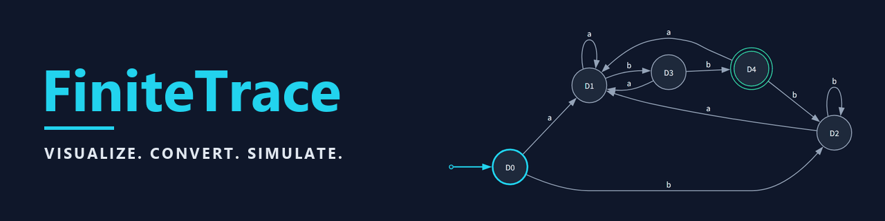
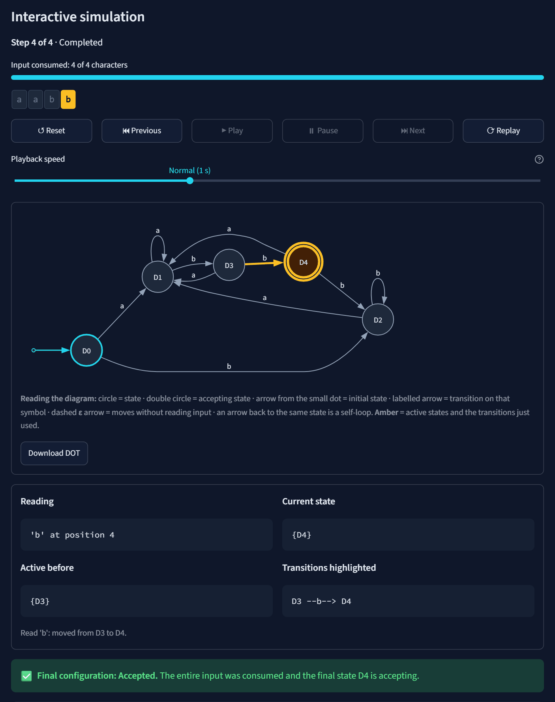
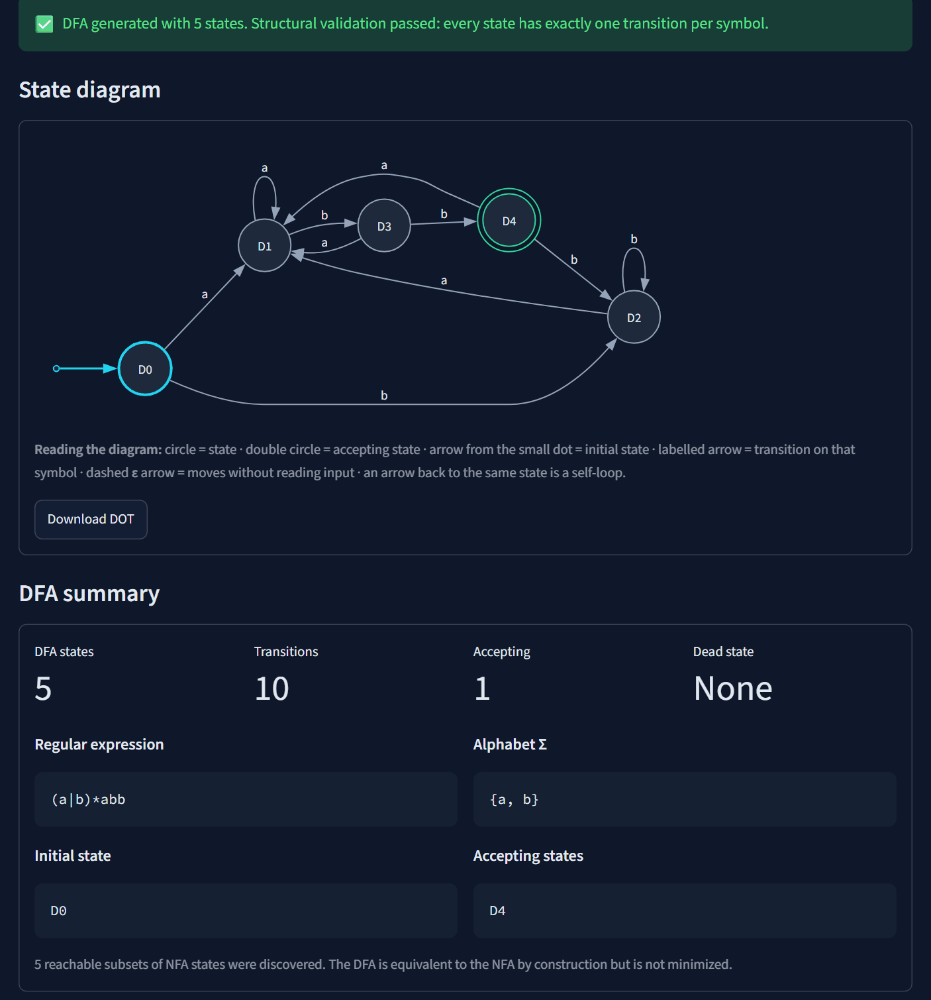
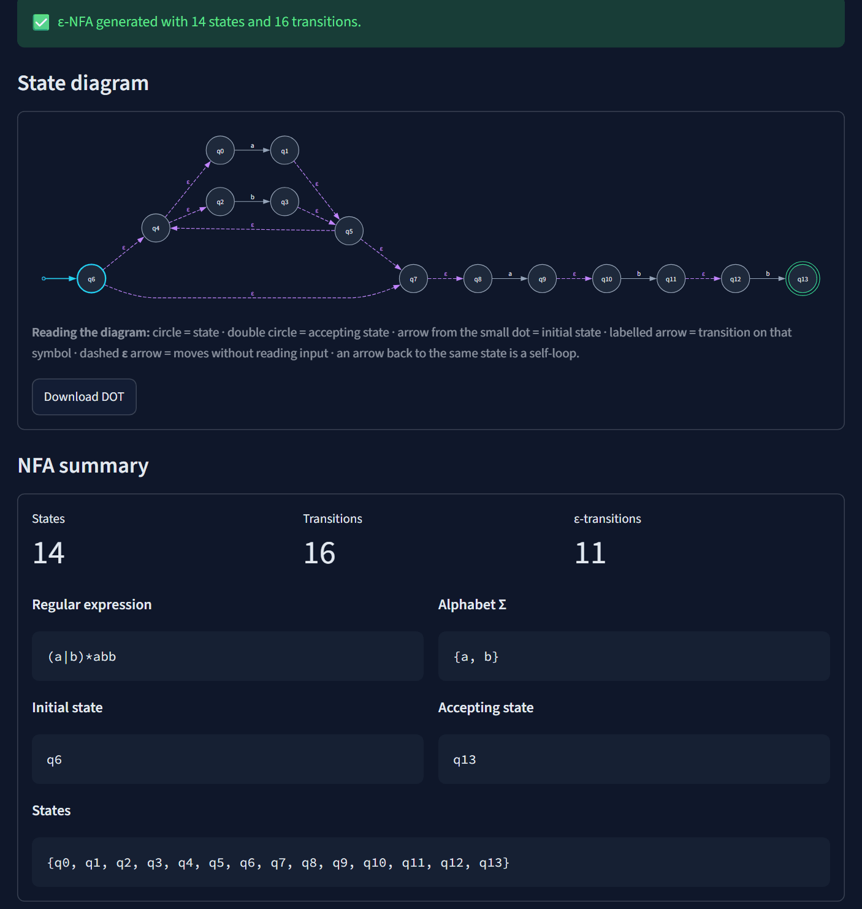
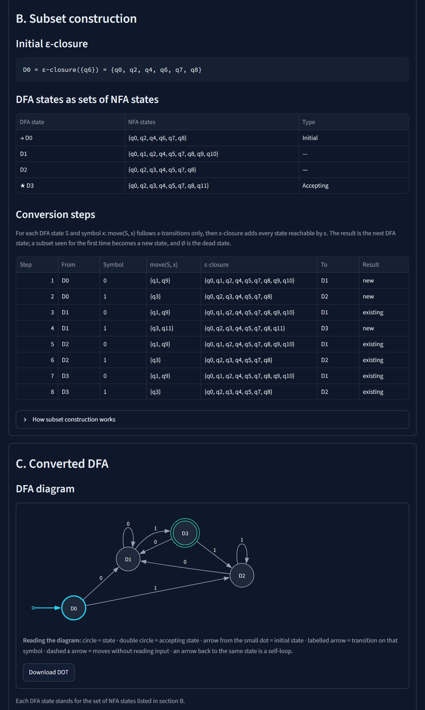
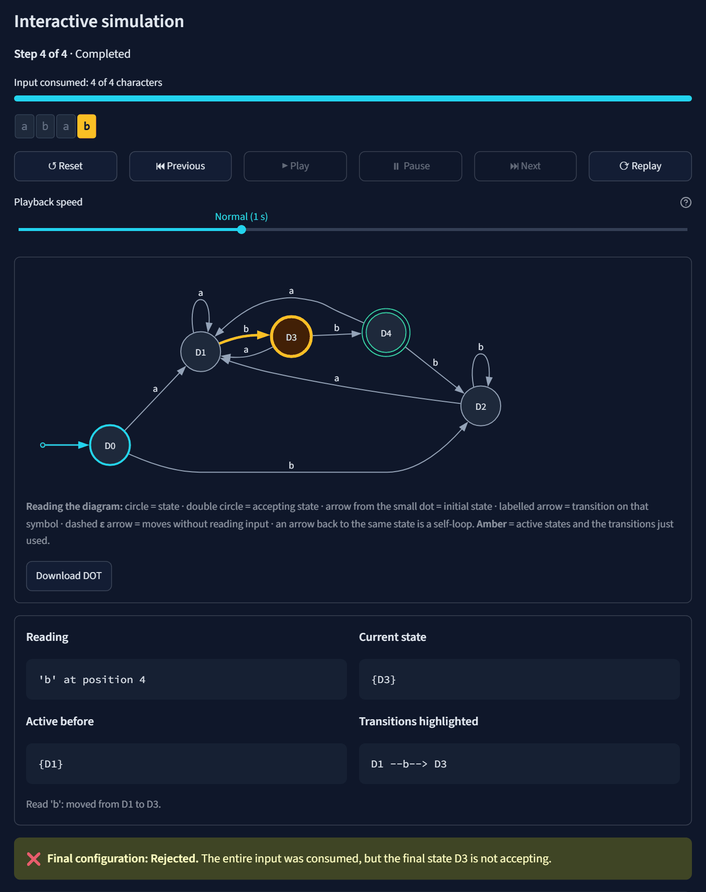
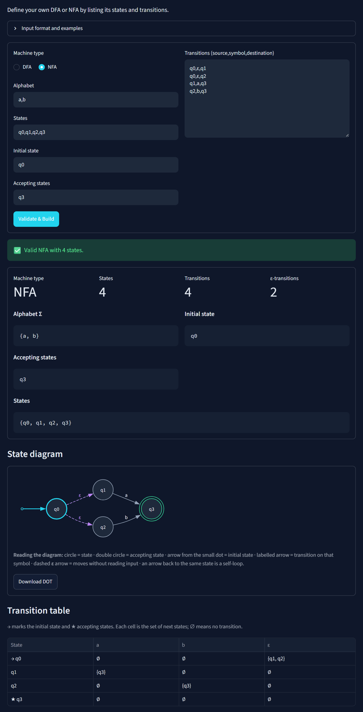
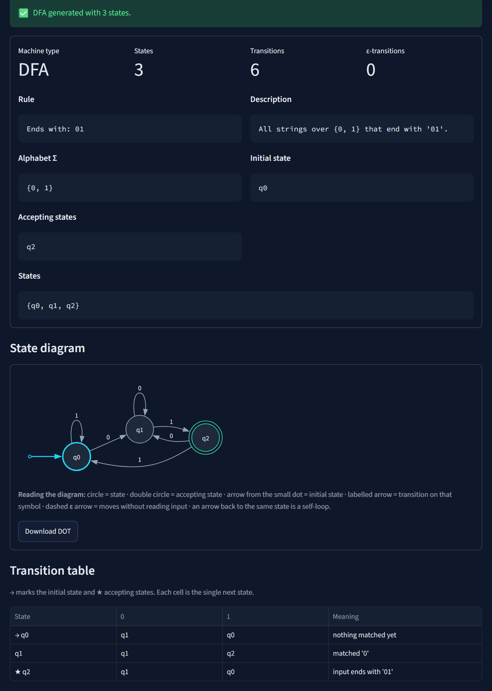

<p align="center">
  
</p>

<p align="center">
  <a href="https://github.com/muhammadtaimoorajmal/finite-trace/releases/tag/v1.0.0"></a>
  <a href="https://github.com/muhammadtaimoorajmal/finite-trace/actions/workflows/tests.yml"></a>
  
  
  <a href="LICENSE"></a>
</p>

# FiniteTrace

**Visualize. Convert. Simulate.**

FiniteTrace is an interactive tool for building, visualizing, converting and simulating finite automata: deterministic (DFA), nondeterministic (NFA) and ε-NFA. Turn a regular expression into an ε-NFA, convert it to a DFA step by step, and watch a string being processed on the state diagram. All automata algorithms are implemented from scratch in readable Python, with a Streamlit interface.



## What is FiniteTrace?

FiniteTrace takes a description of a regular language and builds the automaton for it. It then lets you inspect that automaton and test strings against it:

- **Builds** DFAs and NFAs from a regular expression, a structured language rule, an exact string, or a definition you type in yourself.
- **Supports ε-transitions** (moves that consume no input) throughout.
- **Converts** any NFA into an equivalent DFA with subset construction, showing every ε-closure and `move` step.
- **Draws** each automaton as a state diagram, with a matching transition table.
- **Simulates** test strings, reports **Accepted** or **Rejected** with the reason, and replays each step on the diagram.

## Key features

| | |
| --- | --- |
| **Regular expressions → ε-NFA → DFA** | Formal regex parser with clear, positioned errors; Thompson's construction; subset construction with a full trace |
| **Four input methods** | Regular expression, language rule (starts/ends with, contains, parity, exactly *k*…), exact string, manual DFA/NFA |
| **State diagrams** | Initial arrow, double-circle accepting states, dashed ε-arrows, self-loops; automatic layout; DOT download |
| **String simulation** | DFA and NFA (active-state sets with ε-closure), empty-string support, step-by-step trace |
| **Interactive playback** | Play, pause, previous, next, reset, replay and speed; active states and used transitions highlighted |
| **Correct by construction, verified by tests** | 700+ automated tests, including checks against independent oracles, and CI on Python 3.11 and 3.13 |

## Visual walkthrough

| | |
| --- | --- |
|  |  |
| **Automata Builder:** the 5-state DFA for `(a\|b)*abb`, with D4 accepting. | **Thompson's construction:** the 14-state ε-NFA, with ε-transitions dashed. |
|  |  |
| **NFA to DFA Converter:** every `move` and ε-closure step, and the resulting DFA. | **A rejected string:** `abab` ends in D3, which is not accepting. |
|  |  |
| **Manual input:** an ε-NFA typed as `source,symbol,destination` rows. | **Language rules:** "ends with `01`" as a 3-state DFA. |

## Quick start

Requires **Python 3.11 or newer**. No system Graphviz installation is needed; diagrams are drawn in the browser.

**Windows**

```powershell
git clone https://github.com/muhammadtaimoorajmal/finite-trace.git
cd finite-trace
python -m venv .venv
.venv\Scripts\python.exe -m pip install -r requirements.txt
.venv\Scripts\python.exe -m streamlit run app.py
```

**macOS / Linux**

```bash
git clone https://github.com/muhammadtaimoorajmal/finite-trace.git
cd finite-trace
python3 -m venv .venv
.venv/bin/python -m pip install -r requirements.txt
.venv/bin/python -m streamlit run app.py
```

Then open http://localhost:8501.

## Supported inputs

| Input | Example | Notes |
| --- | --- | --- |
| **Regular expression** | `(a\|b)*abb`, `(0\|1)*01`, `(a\|ε)b`, `a\|b` | Union `\|`, concatenation (implicit or `.`), `*`, `+`, `?`, parentheses, `ε`/`λ`, `\` to escape an operator |
| **Language rule** | alphabet `0,1`, *Ends with* `01` | Starts with, ends with, contains, does not contain, does not end with, even/odd number of a symbol, exactly *k* occurrences |
| **Exact string** | alphabet `a,b`, string `aabb` | Accepts exactly that string, taken literally; empty = only ε |
| **Manual automaton** | `q0,ε,q1` one row per transition | DFA (must be complete) or NFA/ε-NFA, with any valid state names |

The full syntax and input formats are in the [User Guide](docs/USER_GUIDE.md).

## Usage examples

| Try this | You will see |
| --- | --- |
| Builder → `(a\|b)*abb` → **Generate DFA** | A 5-state DFA (D0–D4) with D4 accepting |
| Simulator → `(a\|b)*abb`, DFA, `aabb` → **Simulate String** → **▶ Play** | **Accepted**, playing D0 → D1 → D1 → D3 → D4 |
| Simulator → same, test string `abab` | **Rejected**: ends in D3 |
| Simulator → `a*` with an empty test string | **Accepted** (`a+` would be rejected) |
| Converter → `(0\|1)*01` → **Convert NFA to DFA** | A 12-state ε-NFA becomes a 4-state DFA, with every step shown |

FiniteTrace can also be used from Python:

```python
from core.converter import regex_to_dfa
from core.simulator import simulate

dfa = regex_to_dfa("(a|b)*abb")
result = simulate(dfa, "aabb")
print(result.accepted, result.explanation)
```

## Architecture

```text
input → regex_parser → thompson ─┐
       language_builder ─────────┼→ FiniteAutomaton → converter → simulator → playback
       manual_builder ───────────┘          └→ visualizer (diagram) / tables
```

All algorithms live in `core/` (plain Python, no UI code); the Streamlit interface is in `ui/` and `app.py`. See [docs/ARCHITECTURE.md](docs/ARCHITECTURE.md) for the design, and [docs/CODE_WALKTHROUGH.md](docs/CODE_WALKTHROUGH.md) for a beginner-friendly tour of the code with 30 questions and answers.

## Testing

```bash
# Windows
.venv\Scripts\python.exe -m pytest
# macOS / Linux
.venv/bin/python -m pytest
```

The suite covers each algorithm, checks NFAs and DFAs against independent oracles on every short string (plain Python language descriptions, Python's `re`, and a brute-force NFA search), and drives the real interface through Streamlit's `AppTest`. One optional test needs the Graphviz `dot` executable and is skipped without it. [GitHub Actions](https://github.com/muhammadtaimoorajmal/finite-trace/actions/workflows/tests.yml) runs the suite on Python 3.11 and 3.13 for every push and pull request.

## Limitations

- **Formal regular expressions only.** No character classes (`[a-z]`), counted repetition (`{2,4}`), anchors, wildcard `.`, backreferences or lookarounds; these are reported as errors rather than misinterpreted.
- **Structured language rules, not free-form English.** The supported rules are listed above.
- **Finite automata only.** No pushdown automata or Turing machines.
- **No DFA minimization.** Subset construction produces an equivalent DFA, which can have more states than necessary.
- **Size limits:**

  | Limit | Value |
  | --- | --- |
  | Regular expression length | 512 characters |
  | ε-NFA states | 1,500 |
  | DFA states from subset construction | 512 |
  | Test string length | 1,000 characters |
  | Diagram size | 80 states / 250 transitions; larger automata keep their tables, trace and DOT download |
  | Automatic layout | left to right up to 15 states, top to bottom above |
  | Manual input | 150 states, 20 alphabet symbols, 2,000 transition lines, 40-character state names |
  | Language rules | patterns up to 50 characters, exact strings up to 100, counts *k* up to 100 |

- **Graphviz `dot` is optional.** It is only needed to render a downloaded `.dot` file outside FiniteTrace.

## Contributing

Contributions are welcome. See [CONTRIBUTING.md](CONTRIBUTING.md) for setup, tests and guidelines, and [docs/DEMO_GUIDE.md](docs/DEMO_GUIDE.md) for a guided demonstration of every feature.

## License

Released under the [MIT License](LICENSE).

## Release

The current release is **v1.0.0**; see [CHANGELOG.md](CHANGELOG.md) and the [v1.0.0 tag](https://github.com/muhammadtaimoorajmal/finite-trace/releases/tag/v1.0.0).
