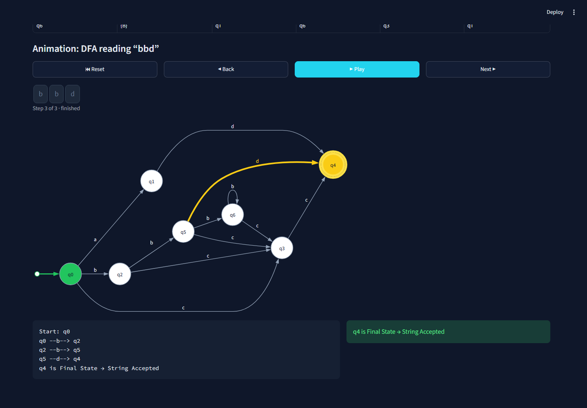

# FiniteTrace: Project 29

**Regular Expression → NFA → NFA to DFA conversion → DFA, with step-by-step animation.**

Semester project for *Theory of Automata*. Student: **Muhammad Taimoor Ajmal**, Project 29.

| | |
| --- | --- |
| **Regular expression** | `(b + bbb + bb)* cc + ad + bbd` |
| **Notation** | `+` = union (OR), `*` = repeat zero or more times, side by side = concatenation |
| **Language** | `b*cc ∪ {ad, bbd}` over the alphabet {a, b, c, d}, because any mix of b, bb and bbb is just any number of b's |
| **Accepted** | `cc`, `bcc`, `bbbbcc`, `ad`, `bbd` |
| **Rejected** | `bd`, `bad`, `bbbd`, `acc`, ε (empty string) |

The app works **only for this regular expression**. Any other regular expression is declined with a warning, and a malformed one gets a clear syntax error.

## 1. The NFA (7 states: A to G)

The NFA has a start state **A**, one branch for each part of the union, and **one final state G** shared by all branches:

| Branch | Path |
| --- | --- |
| `(b + bbb + bb)* cc` | A -b→ B, **B loops on b**, then A or B -c→ C -c→ G |
| `ad` | A -a→ D -d→ G |
| `bbd` | A -b→ E -b→ F -d→ G |

The b-loop has its own state B, not the start state A. If A had the loop, the NFA would also accept `bad` and `bbbd`, which are **not** in the language, because the star only applies to `cc`.


## 2. NFA → DFA conversion (subset construction)

This uses the method from class:

1. The start set {A} becomes DFA state **q0**.
2. For each new set and each symbol, the next set is the union of the NFA moves of its states.
3. A set not seen before becomes the next state q1, q2, …. The empty set φ becomes the **trap state qT**.
4. A DFA state is final if its set contains G.

The app builds the DFA one row at a time and explains every cell, for example `δ({B,E}, b) = δ(B,b) ∪ δ(E,b) = {B} ∪ {F} = {B,F} → q5`.


## 3. The DFA (8 states: q0 to q6 and the trap qT)

| State | NFA states | Meaning | a | b | c | d |
| --- | --- | --- | --- | --- | --- | --- |
| → q0 | {A} | start | q1 | q2 | q3 | qT |
| q1 | {D} | read a | qT | qT | qT | q4 |
| q2 | {B,E} | read b | qT | q5 | q3 | qT |
| q3 | {C} | read b\*c | qT | qT | q4 | qT |
| qT | φ | trap (dead) | qT | qT | qT | qT |
| * q4 | {G} | **final** | qT | qT | qT | qT |
| q5 | {B,F} | read bb | qT | q6 | q3 | q4 |
| q6 | {B} | read bbb… | qT | q6 | q3 | qT |

By default the diagram leaves out qT, as in class: every move that is not drawn goes to qT. Use the **Draw trap state qT** switch to show the complete DFA. During an animation, qT appears as soon as the string reaches it.


## 4. Animation and testing

1. Type any string in the **Test string** box and press **Run ▶**. It runs on both the NFA (tab ①) and the DFA (tab ③).
2. Use **Reset, Back, Play/Pause and Next** to step through it:
   - **NFA:** every current state glows yellow, and each step lists every branch (`A --b--> B`, `A --b--> E`). A branch with no move dies (`B --d--> φ`).
   - **NFA → DFA:** the DFA grows one row at a time.
   - **DFA:** one state at a time, ending with `q4 is Final State → String Accepted` or `qT is not a Final State → String Rejected`.
3. Tab ④ tests many strings at once and shows both traces.



## Project structure

```text
app.py                 Streamlit interface (tabs, tables, diagrams, animation)
automata/
  regex.py             checks the RE: syntax errors, and "is it the Project 29 RE?"
  nfa.py               the NFA: one branch per part of the RE, final state G
  convert.py           NFA -> DFA by subset construction, row by row
  simulate.py          runs a string and builds the trace (q0 --a--> q1 ...)
  model.py             the Automaton class used by both machines
  diagram.py           Graphviz drawing (green start, blue double-circle final)
tests/test_project.py  28 tests
```

## Run it

You need Python 3.11 or newer.

```bash
python -m venv .venv
# Windows
.venv\Scripts\python.exe -m pip install -r requirements.txt
.venv\Scripts\python.exe -m streamlit run app.py
# macOS / Linux
.venv/bin/python -m pip install -r requirements.txt
.venv/bin/python -m streamlit run app.py
```

Then open <http://localhost:8501>. After pulling new code, stop the app with Ctrl+C and start it again.

## Tests

```bash
python -m pytest
```

The tests check:

- every error message
- the NFA
- the DFA table and the conversion steps
- that the DFA is the same machine as the hand-drawn class DFA
- the trace text
- the interface

They also check that **both machines accept exactly `b*cc ∪ {ad, bbd}`**. Every string over {a, b, c, d} up to length 7 is compared with Python's `re`.

## License

MIT
