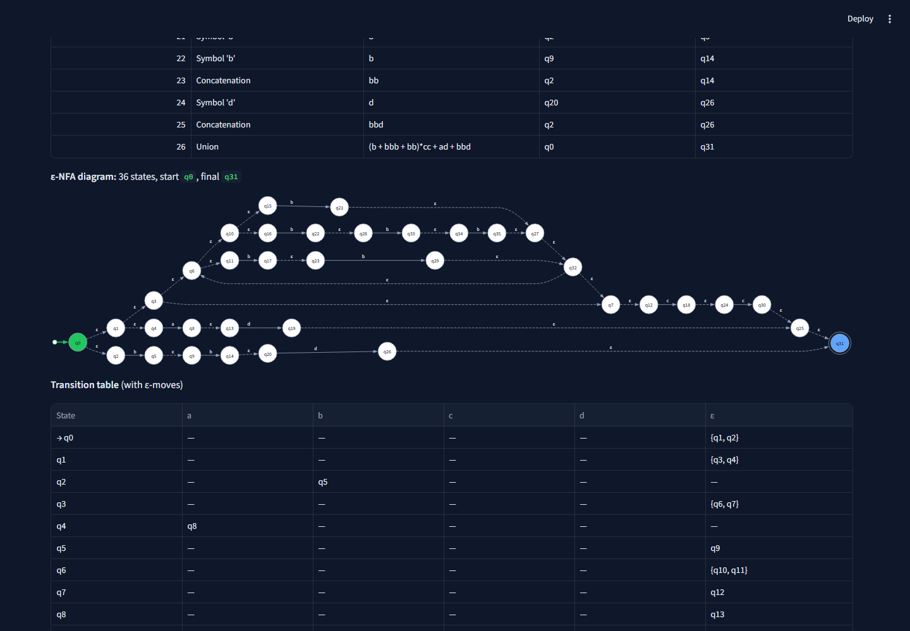
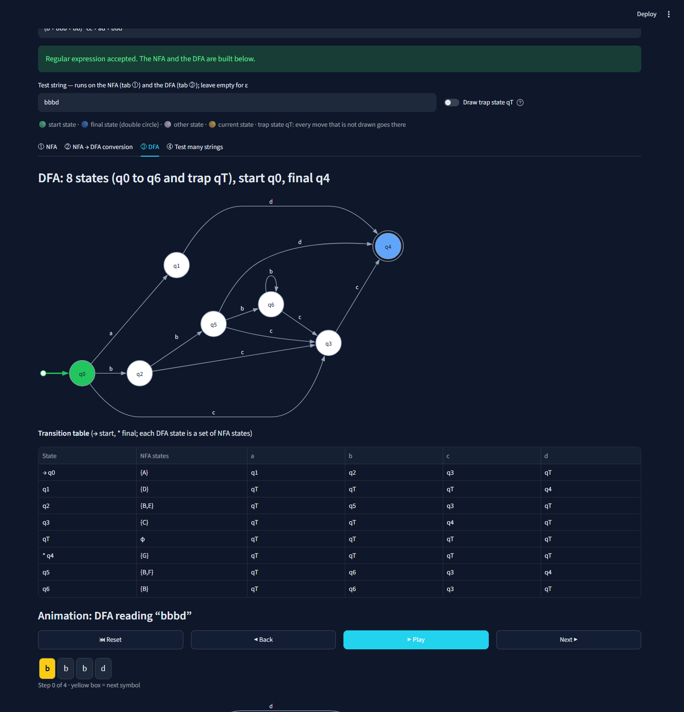
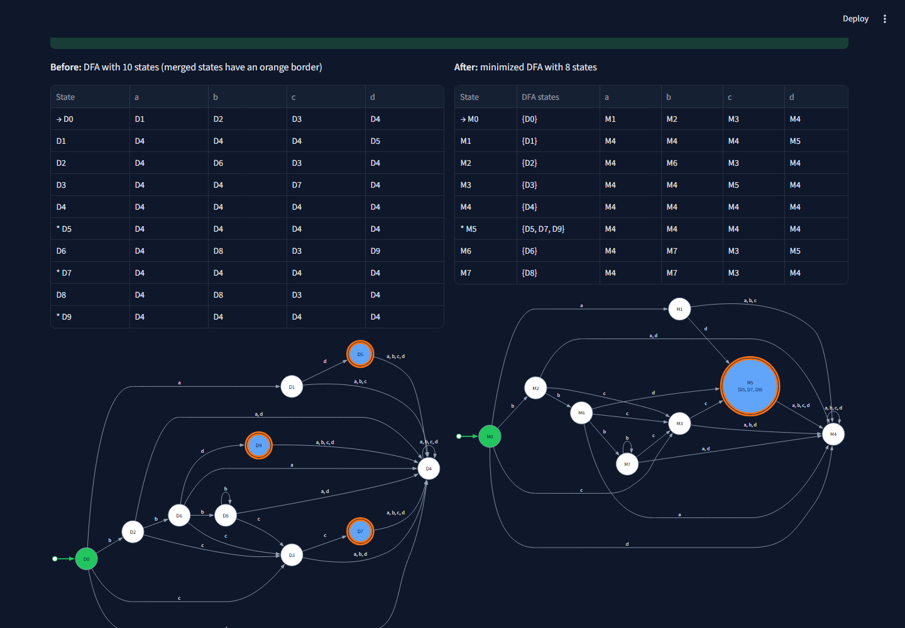
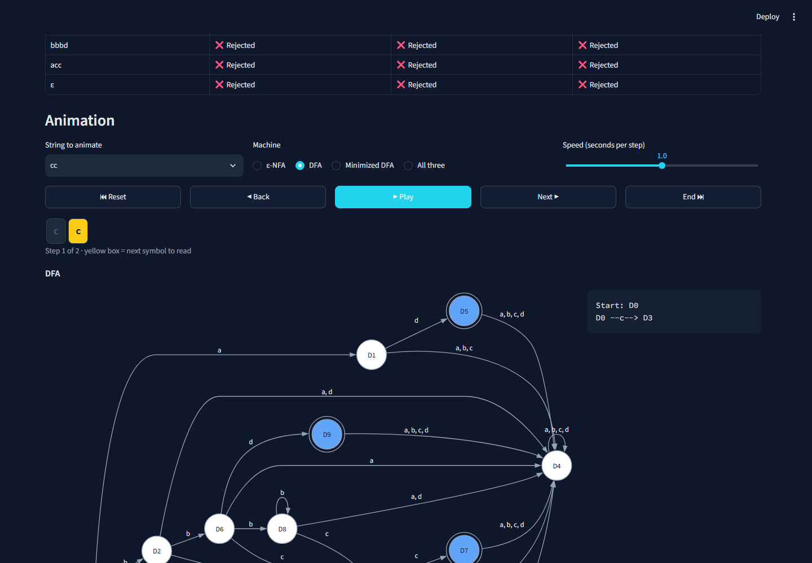

# FiniteTrace: Project 29

**Regular Expression → ε-NFA → DFA → Minimized DFA, with step-by-step animation.**

Semester project for *Theory of Automata*. Student: **Muhammad Taimoor Ajmal**, Project 29.

| | |
| --- | --- |
| **Regular expression** | `(b + bbb + bb)* cc + ad + bbd` |
| **Notation** | `+` = union (OR), `*` = Kleene star, side by side = concatenation |
| **Language** | `b*cc ∪ {ad, bbd}` over the alphabet {a, b, c, d} |
| **Accepted examples** | `cc`, `bcc`, `bbbbcc`, `ad`, `bbd` |
| **Rejected examples** | `bd`, `bbbd`, `acc`, `ccc`, ε (empty string) |


The app is built **only for this regular expression**. Any other regular expression is declined with a warning, and malformed input gets a clear syntax error.

## What it does

| Step | Algorithm | Result for Project 29 |
| --- | --- | --- |
| 1. Validate the RE | Tokenizer and syntax checks, then a comparison with the project RE (spaces ignored) | Error or warning for anything else |
| 2. RE → ε-NFA | **Thompson's construction**, showing all 26 intermediate fragments | 36 states, 41 transitions (28 ε) |
| 3. ε-NFA → DFA | **Subset construction** (ε-closure and move), each DFA state shown as a set of NFA states | 10 states, D0–D9. Final: D5, D7, D9. D4 = ∅ (dead state) |
| 4. DFA → minimal DFA | **Table-Filling method**, with every marked pair, the round it was marked in and why | 8 states. D5 ≡ D7 ≡ D9 merge into M5 |
| 5. Simulation | Runs many strings on all three machines, with an animated, step-by-step trace | e.g. `D0 --a--> D1`, `D1 --d--> D5`, `D5 is Final State → String Accepted` |

Every step shows its transition table. Every machine has a state diagram:
- 🟢 start state
- 🔵 final state (double circle)
- ⚪ normal state
- dashed arrows for ε-moves
- 🟠 border for merged states
- 🟡 the active state during animation

All algorithms are written by hand; no automata library is used.

## Screenshots

| | |
| --- | --- |
|  |  |
| **Thompson ε-NFA:** construction steps, diagram and ε-table | **Subset construction:** DFA states as sets of NFA states |
|  |  |
| **Minimization:** before and after tables, merged states highlighted | **Animation:** play, pause, back, next, speed, plus the trace |

## Input validation

| Input | Message |
| --- | --- |
| `(b + bbb + bb)* cc + ad + bbd` (any spacing) | ✅ Regular expression accepted. All three machines were built. |
| `(a + b)*abb` | ⚠️ Not allowed: '(a + b)*abb' is a valid regular expression, but this machine is built only for Project 29 |
| `(a+b` | ❌ Invalid Regular Expression: Missing closing parenthesis for '(' at position 1. |
| `a++b` | ❌ Invalid Regular Expression: Two operators in a row ('++') at position 3. |
| `a+b)` | ❌ Invalid Regular Expression: Unmatched closing parenthesis at position 4. |
| `*ab` | ❌ Invalid Regular Expression: '*' at position 1 has nothing to repeat. |
| `a()b` | ❌ Invalid Regular Expression: Empty parentheses '()' at position 2. |
| `a#b` | ❌ Invalid Regular Expression: Invalid symbol '#' at position 2. |

Test strings that use a symbol outside {a, b, c, d} are also reported, for example `'abx' contains 'x'`.

## Project structure

```text
app.py                 Streamlit interface: input, tabs, tables, diagrams, animation
automata/
  model.py             Automaton class shared by all three machines
  regex.py             syntax check, "is it the Project 29 RE?", postfix (shunting-yard)
  thompson.py          Thompson's construction: postfix → ε-NFA
  subset.py            ε-closure, move, subset construction: ε-NFA → DFA
  minimize.py          Table-Filling minimization: DFA → minimal DFA
  simulate.py          runs a string on any machine and builds the trace
  diagram.py           Graphviz DOT for the state diagrams
tests/test_project.py  30 tests (validation, machine sizes, language check, interface)
```

How the pieces connect:

```text
text ──regex.validate──▶ regex.to_postfix ──▶ thompson ──▶ subset_construction ──▶ table_filling
                                                │                │                    │
                                                └────────── simulate / diagram ───────┘
```

## Run it

Requires Python 3.11 or newer. No Graphviz installation is needed; diagrams are drawn in the browser.

```bash
python -m venv .venv
# Windows
.venv\Scripts\python.exe -m pip install -r requirements.txt
.venv\Scripts\python.exe -m streamlit run app.py
# macOS / Linux
.venv/bin/python -m pip install -r requirements.txt
.venv/bin/python -m streamlit run app.py
```

Then open http://localhost:8501, press **Build machines**, and explore the four tabs.

## Tests

```bash
python -m pytest
```

The tests check:
- every error message
- that other regular expressions are declined
- the machine sizes (36 → 10 → 8)
- the merged states
- the trace text
- the interface itself

They also check that **all three machines accept exactly `b*cc ∪ {ad, bbd}`**. They compare against Python's `re` on every string over {a, b, c, d} up to length 7 (21,845 strings per machine). GitHub Actions runs the tests on Python 3.11 and 3.13.

## License

MIT
