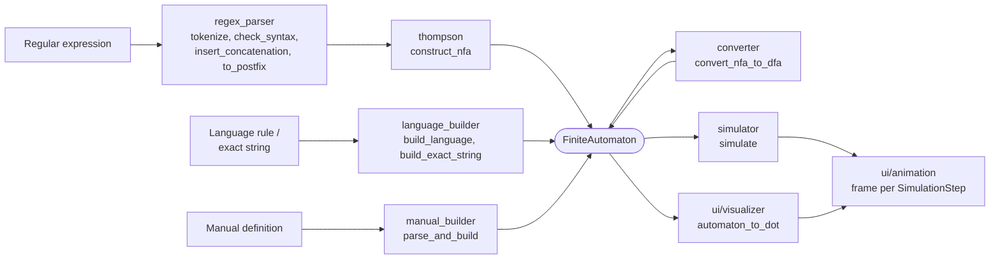

# FiniteTrace Architecture

FiniteTrace is a small Python application in two layers:

- **`core/`**: the automaton model and every algorithm, written in plain Python with no Streamlit or Graphviz imports. Each algorithm can be called and tested on its own.
- **`ui/` and `app.py`**: the Streamlit interface. It collects input, calls `core/`, and draws the results.

No third-party automata library is used. Graphviz is only used to *draw* automata from DOT text.

## Data flow



Every input path ends in the same `FiniteAutomaton`, so conversion, simulation and drawing work the same way whatever the automaton came from.

## Modules

| Module | Responsibility | Main entry points |
| --- | --- | --- |
| `core/automata.py` | The shared DFA/NFA model and structural validation | `FiniteAutomaton`, `validate`, `transition_list`, `state_sort_key` |
| `core/regex_parser.py` | Formal regular expressions to postfix tokens | `parse_regex`, `tokenize`, `check_syntax`, `insert_concatenation`, `to_postfix` |
| `core/thompson.py` | Postfix tokens to ε-NFA (Thompson's construction) | `construct_nfa`, `regex_to_nfa` |
| `core/converter.py` | NFA to DFA (ε-closure, move, subset construction) | `convert_nfa_to_dfa`, `epsilon_closure`, `move`, `regex_to_dfa` |
| `core/language_builder.py` | Structured language rules and exact strings to complete DFAs | `build_language`, `build_exact_string`, `as_nfa` |
| `core/manual_builder.py` | Text definitions of DFAs/NFAs, validated | `parse_manual_definition`, `build_manual_automaton`, `parse_and_build` |
| `core/simulator.py` | Running strings on any automaton, with a full trace | `simulate`, `accepts`, `SimulationResult`, `SimulationStep` |
| `ui/visualizer.py` | DOT generation and diagram display | `automaton_to_dot`, `build_graph`, `render_automaton_diagram`, `layout_direction` |
| `ui/animation.py` | Playback controller and interactive panel | `PlaybackState`, `advance_playback`, `render_animation` |
| `ui/automaton_view.py` | Shared summaries and transition tables | `render_automaton`, `transition_grid_rows` |
| `ui/builder_modes.py` | Language-rule, exact-string and manual forms | `render_language_mode`, `render_exact_mode`, `render_manual_mode` |
| `ui/simulator_view.py` | The String Simulator tab | `render_simulator_tab` |
| `app.py` | Page layout, header, sidebar and the regular-expression parts of the Builder and Converter | `main` |

## The automaton model

```python
from core.automata import FiniteAutomaton

FiniteAutomaton(
    machine_type="NFA",            # "DFA" or "NFA"
    states={"q0", "q1"},
    alphabet={"a"},
    initial_state="q0",
    accepting_states={"q1"},
    transitions={("q0", "a"): {"q1"}, ("q0", None): {"q1"}},  # (state, symbol) -> set of states
)
```

- Destinations are always a **set**: a DFA has exactly one per symbol, an NFA any number.
- ε is the symbol `None`, so the letter `e` is never mistaken for it; `ε` is only used for display.
- `validate(require_complete=True)` checks the structure. A DFA must be complete and have no ε-moves; every algorithm checks its result this way.

## ε-NFA construction (Thompson's algorithm)

The parser's postfix tokens are read left to right with a stack of **fragments**. A fragment is a small NFA with one entry state and one exit state. Symbols push new fragments; operators pop their operands, combine them with ε-transitions and push the result:

| Token | Construction | New states |
| --- | --- | --- |
| symbol `x` | `start --x--> end` | 2 |
| `ε` | `start --ε--> end` | 2 |
| `A.B` (concatenation) | `A.end --ε--> B.start` | 0 |
| `A\|B` (union) | new start branches by ε to both fragments; both ends lead by ε to a new end | 2 |
| `A*` | new start/end, ε to enter, ε to skip, ε loop from `A.end` back to `A.start` | 2 |
| `A+` | like `A*` without the skip, so `A` must match at least once | 2 |
| `A?` | like `A*` without the loop, so `A` matches at most once | 2 |

When all tokens are processed exactly one fragment remains: its start is the NFA's initial state and its end is the single accepting state. The result is a `FiniteAutomaton` with `machine_type="NFA"` that passes structural validation.

- **ε-transitions** are stored with the symbol `None` and shown as `ε`. ε is never part of the alphabet.
- **State names** are `q0`, `q1`, `q2`, … in creation order. Every construction starts its own counter, so the same expression always produces the same NFA and separate constructions never share states.
- **Limit:** construction stops with an error if more than 1,500 states would be needed. A valid expression within the 512-character limit needs at most about 1,024, so this is a safeguard rather than a practical restriction.

### Thompson example

`(a|b)*abb` has the postfix form `ab|*a.b.b.` and produces an ε-NFA with 14 states (`q0`–`q13`), 16 transitions (11 of them ε), initial state `q6` and accepting state `q13`. The construction trace for `ab|c` is:

| Step | Token | Operation | Result |
| --- | --- | --- | --- |
| 1 | `a` | Literal | New fragment q0 --a--> q1 |
| 2 | `b` | Literal | New fragment q2 --b--> q3 |
| 3 | `.` | Concatenation | Join q0…q1 then q2…q3 with ε from q1 to q2 |
| 4 | `c` | Literal | New fragment q4 --c--> q5 |
| 5 | `\|` | Union | New start q6 branches by ε to q0 and q4; q3 and q5 lead by ε to new end q7 |

### Using Generate ε-NFA

Type an expression in the Automata Builder and press **Generate ε-NFA** (no need to parse first). The app shows the state and transition counts, the alphabet, initial and accepting states, every transition (one row per arrow) and the construction steps. Invalid expressions show the parser's error instead.

In code:

```python
from core.thompson import construct_nfa, regex_to_nfa
from core.regex_parser import parse_regex

nfa = regex_to_nfa("(a|b)*abb")                  # FiniteAutomaton
result = construct_nfa(parse_regex("(a|b)*abb"))  # .automaton and .steps (the trace)
```

## NFA-to-DFA conversion (subset construction)

An NFA can be in several states at once, may have no move for a symbol, and can take ε-moves without reading input. A DFA has exactly one next state for every state and symbol. Subset construction bridges the two: **each DFA state stands for the set of NFA states the NFA could be in**.

Two operations do the work:

- **ε-closure(S):** every state reachable from the states in S using only ε-transitions, including S itself. Computed iteratively with a worklist, so ε-cycles and long ε-chains are safe.
- **move(S, x):** every state reachable from S by reading exactly one `x`. It never follows ε-transitions.

The algorithm:

1. `D0 = ε-closure({initial NFA state})`.
2. Take the next unprocessed DFA state S (breadth-first). For each symbol x in sorted order, compute `ε-closure(move(S, x))`.
3. If that subset has not been seen, name it `D1`, `D2`, … in discovery order and queue it; otherwise reuse its existing name.
4. Repeat until no unprocessed states remain. Only reachable subsets ever become DFA states.

**Accepting states.** A DFA state is accepting if its subset contains **at least one** accepting NFA state.

**Dead state.** When `move` finds nothing, the result is the empty subset `∅`. It becomes a single, non-accepting dead state that loops to itself on every symbol, so the DFA is complete. It only appears if it is reachable, and an empty alphabet never creates one.

**Not minimized.** The DFA recognizes exactly the same language as the NFA, but it may have more states than necessary. For example, `(a|b)*abb` gives 5 states.

**Limit:** conversion stops with an error if more than 512 DFA states would be needed. Subset construction can require exponentially many states, for example `(a|b)*a(a|b)(a|b)(a|b)(a|b)(a|b)(a|b)(a|b)(a|b)(a|b)`. No partial DFA is ever returned.

### Subset-construction example

The ε-NFA with `q0 --ε--> q1`, `q0 --ε--> q2`, `q1 --a--> q3`, `q2 --b--> q3`, initial state `q0` and accepting state `q3` converts as follows:

| Step | From | Symbol | move | ε-closure | To |
| --- | --- | --- | --- | --- | --- |
| – | | | | `ε-closure({q0}) = {q0, q1, q2}` | D0 |
| 1 | D0 | a | {q3} | {q3} | D1 (new) |
| 2 | D0 | b | {q3} | {q3} | D1 |
| 3 | D1 | a | ∅ | ∅ | D2 (new, dead) |
| 4 | D1 | b | ∅ | ∅ | D2 |
| 5 | D2 | a | ∅ | ∅ | D2 |
| 6 | D2 | b | ∅ | ∅ | D2 |

| DFA state | NFA states | a | b |
| --- | --- | --- | --- |
| → D0 | {q0, q1, q2} | D1 | D1 |
| ★ D1 | {q3} | D2 | D2 |
| D2 | ∅ (dead) | D2 | D2 |

The DFA accepts exactly `a` and `b`.

### Using the app

- **Automata Builder → Generate DFA** runs the whole pipeline (parse, Thompson's construction, subset construction) on the current expression and shows a summary, the DFA-state-to-NFA-subset mapping and the transition table.
- **NFA to DFA Converter** has its own input. **Convert NFA to DFA** shows (A) the source ε-NFA, (B) the initial ε-closure, the state mapping and every `move` / `ε-closure` calculation, and (C) the resulting DFA. To convert a manually defined NFA instead, use the converter's **From Manual NFA** tab (see [Converting a manual NFA](USER_GUIDE.md#converting-a-manual-nfa)).

### Subset construction in code

```python
from core.converter import convert_nfa_to_dfa, epsilon_closure, move, regex_to_dfa
from core.thompson import regex_to_nfa

result = convert_nfa_to_dfa(regex_to_nfa("(0|1)*01"))
result.dfa            # FiniteAutomaton with machine_type="DFA"
result.state_mapping  # {"D0": frozenset({...}), ...}
result.steps          # ConversionStep records: subset, symbol, move, ε-closure, destination
result.dead_state     # name of the ∅ state, or None

dfa = regex_to_dfa("(a|b)*abb")  # shortcut: regex -> ε-NFA -> DFA
```

`convert_nfa_to_dfa` accepts any valid `FiniteAutomaton` (NFA or DFA), not only ones built from regular expressions.

## Simulation and playback

`simulate(automaton, text)` keeps a set of active states: step 0 is `ε-closure({initial})`, and each character applies `ε-closure(move(active, x))`. It records one `SimulationStep` per configuration: the active states before and after, the symbol and ε-transitions followed, the position and an explanation. A complete DFA always has exactly one active state, so DFAs and NFAs share the same engine. Repeated (active set, symbol) pairs are computed once, so long inputs stay fast. Usage details are in the [User Guide](USER_GUIDE.md#string-simulation).

The playback panel never simulates anything itself. Frame *i* highlights `steps[i].active_after` and the edges in `steps[i].symbol_edges + steps[i].epsilon_edges` on the existing diagram; highlighting only restyles nodes and edges, so the layout never changes. `PlaybackState` and its functions (`start_playback`, `advance_playback`, …) are plain Python with the clock passed in, so their timing can be unit-tested. Automatic playback uses `st.fragment(run_every=...)`, which reruns only the panel and only while it is playing.

## Interface state

Streamlit reruns the script after every interaction, so results are kept in `st.session_state`. Each result is stored together with the inputs that produced it (a *signature*), and is displayed only while those inputs are unchanged. Editing an expression, test string or manual definition therefore never shows an old result as if it belonged to the new input. Each simulation run gets a new id, so its playback always starts at step 0. Each browser session has its own session state, and there is no module-level mutable state.

The Builder's input modes and the simulator's sources are tabs rather than radio buttons, because Streamlit discards the values of widgets that are not rendered. Tabs keep every mode's inputs alive.

## Safety and limits

- User input is parsed, never executed. There is no `eval`/`exec`, and a test enforces this.
- DOT output uses internal node ids (`s0`, `s1`, …) and escaped labels, so state names and symbols cannot change the diagram's structure. The input tape on the playback panel escapes every character.
- Every expensive step has a limit that stops with an error instead of returning a partial result: 512-character expressions, 1,500 NFA states, 512 DFA states, 1,000-character test strings, and diagrams of up to 80 states / 250 transitions.
- `.streamlit/config.toml` sets `client.showErrorDetails = "none"`. Unexpected errors show a generic message in the browser, and full details go to the server log.

## Testing

| Layer | Files | What is checked |
| --- | --- | --- |
| Algorithms | `test_automata`, `test_regex_parser`, `test_thompson`, `test_converter`, `test_language_builder`, `test_manual_builder`, `test_simulator` | Each algorithm, including exhaustive comparisons with independent oracles on all short strings |
| Diagrams and playback | `test_visualizer`, `test_animation` | The DOT text is read back and compared with the automaton; every playback frame is compared with its trace |
| Interface | `test_app`, `test_app_modes`, `test_simulator_app`, `test_visualizer_app`, `test_animation_app` | Real interactions through Streamlit's `AppTest` |
| Integration | `test_integration`, `test_robustness` | End-to-end user journeys, fixed-seed randomized checks against Python's `re` and a brute-force NFA search, malformed input, limits, escaping, session isolation |

GitHub Actions (`.github/workflows/tests.yml`) runs the suite on Python 3.11 and 3.13.

## Project structure

```text
finite-trace/
├── app.py                     # Streamlit entry point
├── core/
│   ├── __init__.py            # version number
│   ├── automata.py            # FiniteAutomaton model and validation
│   ├── regex_parser.py        # regular expression parser
│   ├── thompson.py            # Thompson's ε-NFA construction
│   ├── converter.py           # ε-closure, move, subset construction
│   ├── language_builder.py    # language rules and exact strings
│   ├── manual_builder.py      # manual DFA/NFA definitions
│   └── simulator.py           # string simulation and traces
├── ui/
│   ├── visualizer.py          # DOT generation and diagrams
│   ├── animation.py           # playback controller and panel
│   ├── automaton_view.py      # summaries and transition tables
│   ├── builder_modes.py       # Builder input forms
│   └── simulator_view.py      # String Simulator tab
├── tests/                     # pytest and Streamlit AppTest suites
├── docs/                      # guides and screenshots
├── .streamlit/config.toml     # theme and error-display settings
├── .github/workflows/tests.yml
├── requirements.txt
├── CHANGELOG.md
├── CONTRIBUTING.md
└── LICENSE
```
